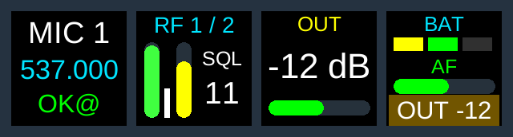
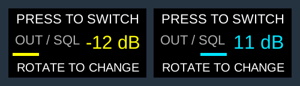
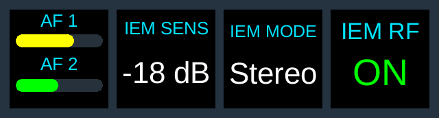

# Sennheiser Evolution Wireless for Bitfocus Companion

A Companion module for controlling and monitoring Sennheiser evolution wireless rack units that support the **Media Control Protocol over UDP 53212**. One connection can manage up to **32 slots** with a mix of EM microphone receivers and SR IEM transmitters. Each slot keeps its assigned device by MAC address when DHCP changes or devices come online in a different order.



*Illustrations in this README are generated from the preset layouts using sample values.*

## Install and connect

1. Build the module or obtain its `.tgz` release package. In Companion, open **Modules → Import module package**. Add a **Sennheiser Evolution Wireless** connection or select the new module version on your existing connection. [Companion module installation](https://companion.free/user-guide/v5.1/config/modules/)
2. Connect the Companion host and the Sennheiser rack units to the same local IPv4 network. Enable the device's network discovery setting where applicable.
3. In the connection settings, set **Number of device slots**. In each **Device** dropdown select the intended unit. The list shows **device name / MAC / current IP**. **Device type** shows the detected EM or SR type and supports a manual override.
4. In **Buttons → Presets**, select the connection and drag buttons from **Microphone systems** or **IEM systems**. Match the slot numbers in your layout. Place rotary presets in the physical encoder row.

The module sends a Sennheiser WSM-compatible multicast discovery query on UDP 8133. It verifies units with the Media Control Protocol on UDP 53212 before listing them. The device list is refreshed in the background every 12 seconds. Open the connection form again to load a fresh list. If no units appear, wait 30 seconds and refresh the admin page.

If a unit is missing, enter its address in **Find a device by IPv4 address**, save, and reopen settings after the probe. A responding unit appears in the **Device** lists. If its MAC cannot be determined, the option is marked **MAC unavailable** and follows the specified IP. An optional fallback scan of directly attached IPv4 subnets is off by default.

Assignments are saved in Companion. If EW2 goes offline while EW1, EW3 and EW4 are connected, EW2 stays reserved. To swap two units, select a device already assigned to another slot. A newly discovered unit becomes available for selection in a free slot. You can keep your existing Companion connection and buttons when updating this module.

### Device and network support

- **EM** presets are for compatible rack microphone receivers such as EM 300/500 G3 and EM 300–500 G4.
- **SR** presets are for compatible rack IEM transmitters such as SR 300 IEM G3 and SR IEM G4. Control applies to the networked transmitter.
- The model and firmware must answer the Media Control Protocol. The EM 300 G3 network behavior was checked on hardware. IEM parsing and commands were checked against the protocol and with simulated replies. A physical IEM transmitter has yet to be tested with this module.
- WSM and Companion may contend for UDP 8133 when running on the same host. For manual-IP discovery, a MAC is determined from an announcement or the local IPv4 neighbor table when available.

See the [Sennheiser G3 Media Control Protocol](https://www.sennheiser.com/globalassets/digizuite/40900-en-ewg3_2000_mediacontrolprotocoldescription_120122.pdf) and [Sennheiser G4 Media Control Protocol](https://www.sennheiser.com/globalassets/digizuite/41944-en-ti_1254_metromediensteuerung_ewg4_en.pdf) for model and firmware requirements.

## Presets and rotary controls

| Microphone preset | What it shows | Encoder behavior |
| --- | --- | --- |
| **Status** | Device name or rack ID, frequency, Mute and connection status | Display |
| **RF 1/2 + SQL** | Both antenna meters, numeric Squelch and the white threshold mark | Rotate for Squelch, ±2 dB |
| **OUT** | Configured AF Out in dB and the receiver's live AF meter | Rotate for AF Out, ±3 dB |
| **AF + Battery** | Three battery segments, live AF and the AF Out setting | Display |
| **Dual encoder** | Selected parameter and its value | Press to switch between AF Out and SQL. Rotate to change the selected parameter |



The **Dual encoder**, **RF 1/2 + SQL** and **AF + Battery** presets share the selected mode for the same slot. If your encoder has no display, look at the adjacent RF and AF buttons. The highlight moves to **SQL** or **OUT** when you press the encoder. The dedicated **OUT** and **RF 1/2 + SQL** rotary actions always adjust their own parameter.

The AF meter shows the peak reported by the receiver. The numeric AF Out value is the analog output gain setting. The AF meter may stay steady when you adjust AF Out. A muted receiver may also report a small AF value.

| IEM preset | What it does |
| --- | --- |
| **Status** | Shows the transmitter's name, frequency and RF Mute status |
| **IEM Input** | Shows both AF input meters |
| **IEM Sensitivity** | Shows input sensitivity in dB. Rotate to adjust by ±3 dB from −42 to 0 dB |
| **IEM Mode** | Shows Mono or Stereo. Press to switch |
| **IEM RF Mute** | Shows the transmitter's RF state. Press to turn the carrier off or on |

Already placed Companion buttons retain the layout copied at placement. To pick up newer graphics or actions, drag the updated preset again.

## Demo groups



Each preset section has its own **Demo** group when the module has found no online device of that type. With only microphone receivers online, the **IEM systems** demo stays visible. With both types online, both demo groups disappear. A device counts once it responds to discovery, even before it is assigned a slot.

Demo buttons use fixed sample readings and carry no control actions. Use the numbered slot presets for live indicators and controls.

## Variables for custom buttons

The variable format is `$(SENN-EW:ew1_<suffix>)`. Replace `SENN-EW` with your Companion connection label and `ew1` with the slot number. For example, `$(SENN-EW:ew3_frequency)` displays the frequency of EW3. In an AF gauge expression, use `$(SENN-EW:ew3_af_level)` with a 0–100 display range.

### Common to EM and SR

| Suffix | Value |
| --- | --- |
| `device_name` | Name reported by the device |
| `online` | `1` when the slot has a responding device, `0` otherwise |
| `rack_id` | Saved rack ID if present, otherwise the slot label, for example `EW1` |
| `display_name` | Rack ID if present, otherwise the device name when online or slot label when offline |
| `frequency` | Frequency in MHz, for example `537.000` |
| `mute_state` | `Muted` or `Unmuted`. For SR, this is RF Mute |
| `mute_number` | `1` muted, `0` unmuted. Use `online` separately to handle an offline unit |
| `last_message` | Device status or warning string, for example `RF_Mute` or `OK` |
| `af_level` | Reported current AF peak. For SR, this is input 1 |

### EM microphone receivers

| Suffix | Value |
| --- | --- |
| `af_out` | Analog output gain setting in dB |
| `battery` | Raw battery status reported by the receiver, or `?` |
| `battery_bars` | `0`–`3` bars, or `-1` if battery information is unavailable |
| `encoder_mode` | `af_out` or `squelch` |
| `squelch` | Receiver squelch setting |
| `rf_level_1` | RF gauge value for antenna 1, based on its reported cycle maximum |
| `rf_level_2` | RF gauge value for antenna 2, based on its reported cycle maximum |
| `rf_min_1` | Antenna 1 minimum RF during the previous cycle |
| `rf_max_1` | Antenna 1 maximum RF during the previous cycle |
| `rf_min_2` | Antenna 2 minimum RF during the previous cycle |
| `rf_max_2` | Antenna 2 maximum RF during the previous cycle |

### SR IEM transmitters

| Suffix | Value |
| --- | --- |
| `af_level_right` | Current AF peak for input 2 |
| `af_peak_hold_1` | AF peak hold for input 1 |
| `af_peak_hold_2` | AF peak hold for input 2 |
| `rf_mute_flags` | Previous cycle: `0` RF on throughout, `1` RF off throughout, `2` state changed |
| `sensitivity` | Input sensitivity in dB |
| `mode` | `Mono` or `Stereo` |

Text readouts can show `---` or `?` when a value is unavailable. Use `online` to condition your custom button styling.

## Build from source

Use Node.js 22 and npm from the repository root.

```bash
npm ci
npm run build
```

The build produces `sennheiser-ew-2.0.0.tgz` for import into Companion. For local development, follow the [Companion development folder setup](https://companion.free/for-developers/module-development/local-modules/). See [Companion packaging](https://companion.free/for-developers/module-development/module-lifecycle/module-packaging/) for details.

Before publishing to your own GitHub repository, replace the example repository, issues and maintainer values in `companion/manifest.json`.

## License and credits

MIT. The source retains the upstream license notice.
